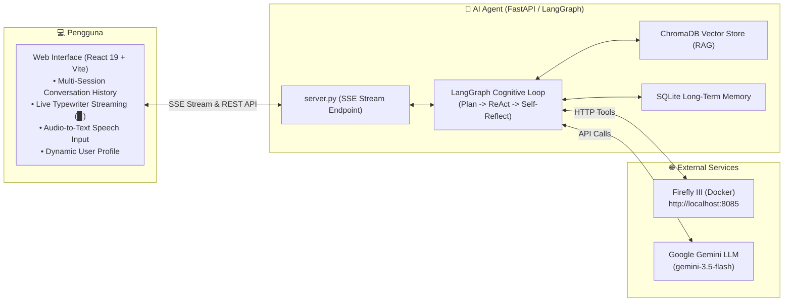

# 🌟 Firefly III AI Financial Agent

[](https://www.docker.com/)
[](https://www.firefly-iii.org/)
[](https://www.python.org/)
[](https://langchain-ai.github.io/langgraph/)
[](https://ai.google.dev/)
[](https://react.dev/)
[](https://vitejs.dev/)

> **Autonomous Level 2 Financial AI Agent** yang terintegrasi langsung dengan software keuangan pribadi **Firefly III**. Dilengkapi dengan pemrosesan kognitif mandiri (_Planning, Tool Execution, Self-Reflection_), Dynamic RAG Vector Store, Long-Term Memory SQLite, Audio-to-Text Input, serta **Live Streaming Response** kata demi kata dengan antarmuka web modern bergaya Dark Glassmorphism.

---

## 📑 Daftar Isi

- [Arsitektur Sistem](#-arsitektur-sistem)
- [Prasyarat Sistem](#-prasyarat-sistem)
- [Langkah 1: Menjalankan Firefly III Menggunakan Docker](#-langkah-1-menjalankan-firefly-iii-menggunakan-docker)
- [Langkah 2: Registrasi User Pertama Kali di Firefly III](#-langkah-2-registrasi-user-pertama-kali-di-firefly-iii)
- [Langkah 3: Mengambil API Token Firefly III & Google Gemini](#-langkah-3-mengambil-api-token-firefly-iii--google-gemini)
  - [3.1 Mengambil Personal Access Token (PAT) Firefly III](#31-mengambil-personal-access-token-pat-firefly-iii)
  - [3.2 Mengambil API Key Google Gemini](#32-mengambil-api-key-google-gemini)
- [Langkah 4: Konfigurasi Environment AI Agent (.env)](#-langkah-4-konfigurasi-environment-ai-agent-env)
- [Langkah 5: Menjalankan Backend AI Agent (Python FastAPI)](#-langkah-5-menjalankan-backend-ai-agent-python-fastapi)
- [Langkah 6: Menjalankan Frontend Web AI Agent (React + Vite)](#-langkah-6-menjalankan-frontend-web-ai-agent-react--vite)
- [Panduan Penggunaan & Contoh Perintah](#-panduan-penggunaan--contoh-perintah)
- [Daftar Endpoint API & Menu Terkait di Firefly III](#-daftar-endpoint-api--menu-terkait-di-firefly-iii)
- [Troubleshooting & FAQ](#-troubleshooting--faq)

---

## 🏛️ Arsitektur Sistem



---

## 💻 Prasyarat Sistem

Sebelum memulai instalasi, pastikan software berikut telah terpasang di komputer Anda:

- [Docker Desktop](https://www.docker.com/products/docker-desktop/) (dengan fitur Docker Compose aktif).
- [Python 3.10](https://www.python.org/downloads/) atau versi lebih baru.
- [Node.js 18+](https://nodejs.org/) & `npm`.
- Akun Google untuk mengakses [Google AI Studio](https://aistudio.google.com/).

---

## 🐳 Langkah 1: Menjalankan Firefly III Menggunakan Docker

Firefly III dan database MariaDB dijalankan secara terisolasi menggunakan Docker Compose yang sudah disiapkan di root folder proyek ini.

### 1.1 Siapkan File Environment Docker

Di folder utama proyek (root workspace), salin file template environment:

```bash
# Salin konfigurasi database MariaDB
cp .db.env.example .db.env

# Salin konfigurasi utama Firefly III
cp .env.example .env
```

> [!IMPORTANT]
> Buka file `.env` yang baru dibuat di root folder, pastikan nilai `APP_KEY` berisi string acak tepat **32 karakter**, contoh:
>
> ```ini
> APP_KEY=w8XqN4yZp2Lm5Rt9Cv7B1Kf3Js6Dh0Ag
> ```

### 1.2 Jalankan Docker Compose

Jalankan perintah berikut pada terminal di root folder:

```bash
docker compose up -d
```

### 1.3 Periksa Status Container

Pastikan ketiga container (`firefly_iii_core`, `firefly_iii_db`, `firefly_iii_cron`) berjalan dengan status _Up_:

```bash
docker compose ps
```

Container Firefly III kini dapat diakses melalui browser di:  
👉 **`http://localhost:8085`**

---

## 👤 Langkah 2: Registrasi User Pertama Kali di Firefly III

Saat Firefly III pertama kali dijalankan, database masih kosong dan belum memiliki pengguna. Pengguna pertama yang mendaftar akan secara otomatis menjadi **Site Owner / Administrator**.

1. Buka browser dan kunjungi **`http://localhost:8085`**.
2. Anda akan langsung diarahkan ke halaman **Register a new account**.
3. Isi data registrasi:
   - **Email address**: Masukkan alamat email Anda (misal: `admin@example.com`).
   - **Password**: Buat kata sandi yang aman.
   - **Password confirmation**: Ulangi kata sandi.
4. Klik tombol **Register**.
5. **Wizard Pengaturan Awal (First-Time Setup)**:
   - Pilih mata uang utama (misalnya: **IDR - Indonesian Rupiah**, simbol `Rp`).
   - Buat nama akun aset/bank pertama Anda (misalnya: `Rekening BCA` atau `Dompet Utama`).
   - Masukkan saldo awal jika diinginkan, lalu simpan.
6. Anda sekarang berada di **Dashboard Utama Firefly III**.

---

## 🔑 Langkah 3: Mengambil API Token Firefly III & Google Gemini

AI Agent membutuhkan 2 kunci otorisasi: Token API dari Firefly III (untuk membaca & memanipulasi data finansial) dan API Key dari Google Gemini (sebagai otak penalaran LLM).

### 3.1 Mengambil Personal Access Token (PAT) Firefly III

1. Pada dashboard Firefly III (**`http://localhost:8085`**), klik menu **Profile** pada sidebar kiri atau klik nama user Anda di pojok kanan/kiri atas.
2. Pilih sub-menu **Profile** (atau langsung akses URL: **`http://localhost:8085/profile`**).
3. Klik tab **OAuth** di bagian atas halaman profil.
4. Di bagian bawah pada kotak **Personal Access Tokens**, klik tombol **Create New Token**.
5. Isi formulir:
   - **Name**: Masukkan nama aplikasi, contoh: `FireflyAIAgent`.
   - **Scopes**: Kosongkan (default full access) atau biarkan standar.
6. Klik **Create**.
7. Modal pop-up akan menampilkan token yang sangat panjang (`eyJh...`).
   > [!WARNING]
   > **Salin dan simpan token tersebut sekarang ke Notepad!** Token ini hanya ditampilkan **satu kali**. Jika hilang, Anda harus membuat token baru.

---

### 3.2 Mengambil API Key Google Gemini

1. Kunjungi website resmi [Google AI Studio](https://aistudio.google.com/app/apikey).
2. Login menggunakan akun Google Anda.
3. Klik tombol **Get API key** atau **Create API key**.
4. Pilih project Google Cloud yang ada atau pilih opsi _"Create API key in new project"_.
5. Salin token API Key yang diawali dengan `AIzaSy...`.

---

## ⚙️ Langkah 4: Konfigurasi Environment AI Agent (`.env`)

Kini tempatkan kedua API token yang telah diperoleh ke dalam konfigurasi AI Agent.

1. Buka terminal dan masuk ke folder `firefly-aiagent`:
   ```bash
   cd firefly-aiagent
   ```
2. Gandakan file `.env.example` menjadi `.env`:
   ```bash
   cp .env.example .env
   ```
3. Buka file `firefly-aiagent/.env` menggunakan text editor (VS Code, Notepad, dll), lalu isi token Anda:

   ```ini
   # ── Firefly III Configuration ────────────────────────────────
   FIREFLY_BASE_URL=http://localhost:8085
   FIREFLY_API_TOKEN=masukkan_token_personal_access_token_firefly_disini

   # ── Google Gemini LLM ────────────────────────────────────────
   GEMINI_API_KEY=masukkan_api_key_google_gemini_disini

   # Model rekomendasi (cepat, cerdas, hemat kuota):
   LLM_MODEL=gemini-2.5-flash
   ```

4. Simpan file `.env`.

---

## 🚀 Langkah 5: Menjalankan Backend AI Agent (Python FastAPI)

Backend bertugas menghubungkan LangGraph Cognitive Engine, database memory SQLite, ChromaDB RAG, Firefly III API, dan Google Gemini.

### 5.1 Buat Virtual Environment Python

Pastikan Anda berada di dalam folder `firefly-aiagent`:

```bash
cd firefly-aiagent

# Buat virtual environment bernama .venv
python -m venv .venv

# Aktifkan virtual environment:
# Untuk Windows (Command Prompt / PowerShell):
.venv\Scripts\activate

# Untuk Linux / macOS:
source .venv/bin/activate
```

### 5.2 Install Dependensi Python

```bash
pip install -r requirements.txt
```

### 5.3 Jalankan Server AI Agent

Jalankan file `server.py`:

```bash
python server.py
```

Server backend FastAPI akan berjalan di:  
👉 **`http://localhost:8000`**

Untuk memverifikasi koneksi backend dengan Firefly III dan Gemini, buka browser ke:  
👉 **`http://localhost:8000/api/health`**  
_(Akan mengembalikan status `"firefly_status": "connected"`, versi Firefly III, dan info user aktif)_.

> [!TIP]
> **Opsi Terminal CLI**: Jika ingin menjalankan AI Agent langsung di command prompt tanpa browser, jalankan perintah:
>
> ```bash
> python main.py
> ```

---

## 🎨 Langkah 6: Menjalankan Frontend Web AI Agent (React + Vite)

Antarmuka web AI Agent dibangun dengan React 19, Lucide Icons, dan Vite dengan fitur **Live Streaming kata demi kata** dan **Audio-to-Text Voice Input**.

### 6.1 Buka Terminal Baru & Masuk ke Folder Frontend

Buka jendela terminal baru (biarkan `server.py` tetap berjalan di terminal sebelumnya):

```bash
cd firefly-aiagent/frontend
```

### 6.2 Install Dependensi Node.js

```bash
npm install
```

### 6.3 Jalankan Development Server

```bash
npm run dev
```

Frontend web kini aktif dan dapat dibuka di browser pada alamat:  
👉 **`http://localhost:5173`**

_(Frontend Vite secara otomatis melakukan proxy permintaan `/api` ke backend `http://localhost:8000`)_.

---

## 💡 Panduan Penggunaan & Contoh Perintah

Anda dapat mengetikkan instruksi finansial dalam Bahasa Indonesia natural, atau menekan **tombol mikrofon 🎙️** untuk berbicara langsung:

### 1. Pengecekan Rekening & Saldo

- _"Tampilkan daftar seluruh rekening dan saldonya"_
- _"Berapa total uang yang saya miliki di rekening BCA?"_

### 2. Pencatatan Transaksi & Pengeluaran

- _"Catat pengeluaran makan siang di Warteg sebesar Rp 35.000 dari Dompet Tunai kategori Makanan"_
- _"Catat pemasukan gaji bulanan Rp 8.500.000 ke Rekening BCA"_
- _"Transfer uang Rp 500.000 dari Rekening BCA ke Dompet Tunai"_

### 3. Pemantauan Budget & Batasan Pengeluaran

- _"Cek status budget bulan ini, apakah ada yang melebihi batas?"_
- _"Buatkan budget baru untuk Hiburan sebesar Rp 1.000.000 per bulan"_

### 4. Celengan Digital (Piggy Banks / Savings Goal)

- _"Lihat daftar target celengan dan progresnya saat ini"_
- _"Buatkan celengan baru untuk 'Liburan Akhir Tahun' dengan target Rp 5.000.000"_

### 5. Tagihan Rutin (Bills) & Histori Transaksi

- _"Cek daftar tagihan rutin dan tanggal jatuh tempo berikutnya"_
- _"Cari transaksi pengeluaran di atas Rp 200.000 selama 30 hari terakhir"_

### 6. Memori Jangka Panjang & Preferensi Finansial

- _"Ingat bahwa setiap pengeluaran di atas Rp 1.000.000 harus meminta konfirmasi saya terlebih dahulu"_
- _(AI Agent akan menyimpan aturan ini ke database SQLite memory dan selalu mengingatnya pada sesi berikutnya)_.

---

## 📊 Daftar Endpoint API & Menu Terkait di Firefly III

Saat AI Agent mengeksekusi perintah Anda, perubahan data dapat Anda pantau langsung di web Firefly III (`http://localhost:8085`):

| Fitur / Aksi AI Agent       | Tools Internal Agent                   | Endpoint Firefly III           | Menu Cek di Firefly III (`:8085`)   |
| :-------------------------- | :------------------------------------- | :----------------------------- | :---------------------------------- |
| **Profil User Login**       | `get_user_info`                        | `GET /api/v1/about/user`       | **Profile -> Options**              |
| **Rekening & Saldo**        | `get_accounts`                         | `GET /api/v1/accounts`         | Menu **Accounts -> Asset accounts** |
| **Transaksi Pengeluaran**   | `create_transaction`                   | `POST /api/v1/transactions`    | Menu **Transactions -> Expenses**   |
| **Transaksi Pemasukan**     | `create_deposit`                       | `POST /api/v1/transactions`    | Menu **Transactions -> Revenue**    |
| **Transfer Antar Rekening** | `create_transfer`                      | `POST /api/v1/transactions`    | Menu **Transactions -> Transfers**  |
| **Anggaran / Budget**       | `get_budgets`, `create_budget`         | `GET/POST /api/v1/budgets`     | Menu **Budgets**                    |
| **Celengan / Tabungan**     | `get_piggy_banks`, `create_piggy_bank` | `GET/POST /api/v1/piggy-banks` | Menu **Piggy banks**                |
| **Tagihan Rutin**           | `get_bills`                            | `GET /api/v1/bills`            | Menu **Bills**                      |

---

## 🛠️ Troubleshooting & FAQ

### 1. Error `429 Resource Exhausted / Quota Limit` pada Gemini

- **Penyebab**: Batas request per menit (RPM) akun gratis Gemini tercapai.
- **Solusi**: Di file `firefly-aiagent/.env`, gunakan model berkecepatan tinggi dengan kuota ringan:
  ```ini
  LLM_MODEL=gemini-2.5-flash
  # atau
  LLM_MODEL=gemini-3.5-flash-lite
  ```

### 2. Status Firefly III Menunjukkan `offline` di Web Agent

- Pastikan Docker container Firefly III aktif dengan menjalankan `docker compose ps` di root folder.
- Pastikan URL di `firefly-aiagent/.env` adalah `FIREFLY_BASE_URL=http://localhost:8085`.
- Pastikan Personal Access Token (PAT) valid dan belum kedaluwarsa.

### 3. Mengganti Akun atau Multi-User

- Jika Anda logout atau login dengan akun pengguna lain di Firefly III, buat token PAT baru dari akun tersebut, lalu perbarui `FIREFLY_API_TOKEN` pada file `.env`.
- Frontend AI Agent secara dinamis membaca dan menampilkan nama dan email pengguna yang sedang aktif.

### 4. Menjalankan Mode Production Full Bundle

Jika Anda tidak ingin menjalankan 2 terminal (`server.py` dan `npm run dev`), Anda cukup melakukan build frontend sekali saja:

```bash
cd firefly-aiagent/frontend
npm run build
```

Setelah build selesai, folder `frontend/dist` akan otomatis dilayani langsung oleh server FastAPI. Anda hanya perlu menjalankan:

```bash
cd firefly-aiagent
python server.py
```

Lalu buka **`http://localhost:8000`** langsung di browser Anda!

---

## 📄 Lisensi

Proyek ini dibuat untuk keperluan akademik dan pengembangan sistem komputasi interaktif agentic AI finansial. Bebas dimodifikasi dan dikembangkan untuk penggunaan pribadi maupun riset.
