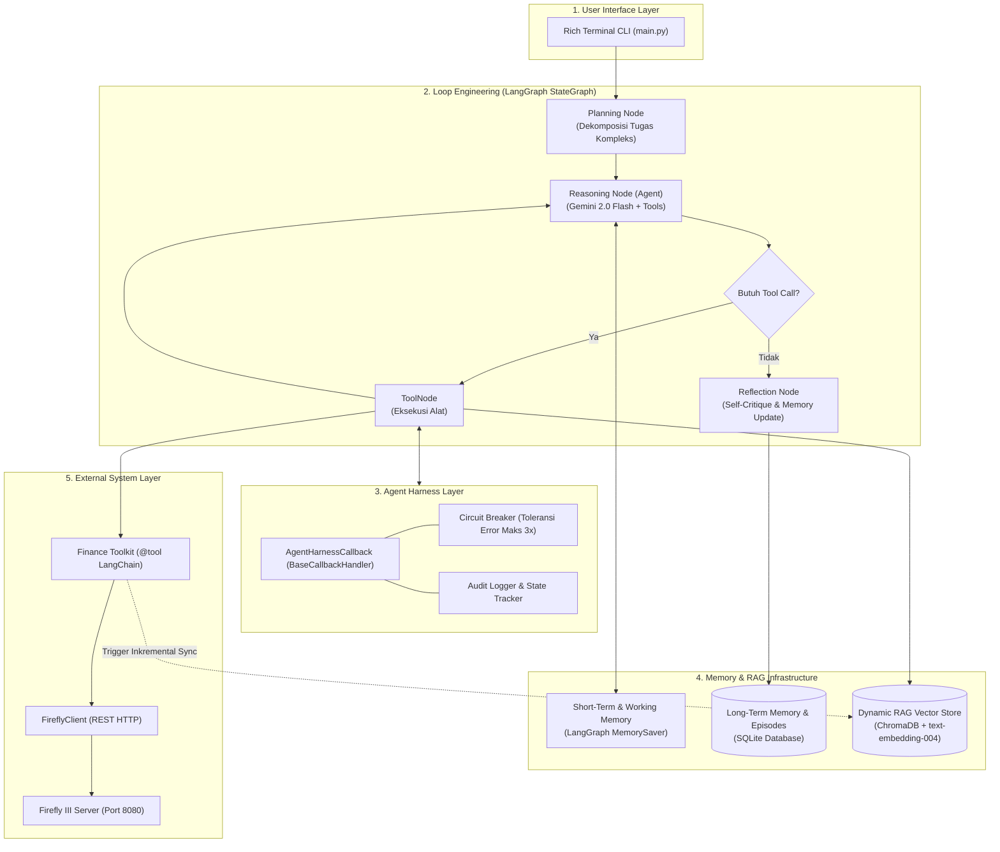
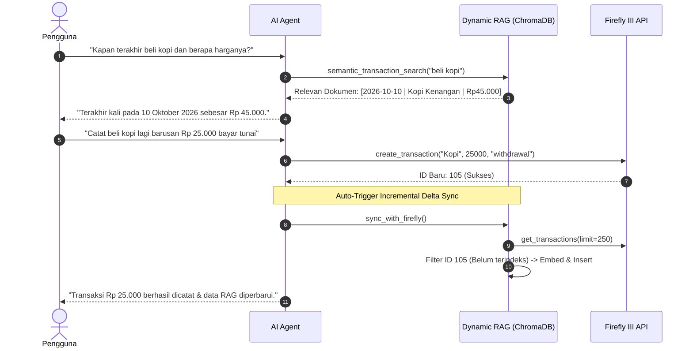

# Technical Architecture Specification
## Firefly III AI Agent (Level 2)

Dokumen ini mendefinisikan arsitektur sistem, struktur data, kontrak antarmuka (*interface contracts*), dan diagram alur kerja teknis untuk AI Agent Level 2 Firefly III berbasis **LangChain**, **LangGraph**, dan **Google Gemini**.

---

## 1. Diagram Arsitektur Tingkat Tinggi



---

## 2. Definisi State Graf (LangGraph `AgentState`)

State yang mengalir di sepanjang node LangGraph didefinisikan sebagai berikut:

```python
from typing import Annotated, Sequence, TypedDict
from langchain_core.messages import BaseMessage
from langgraph.graph.message import add_messages

class AgentState(TypedDict):
    """Representasi state internal yang dibagi antar node kognisi."""
    messages: Annotated[Sequence[BaseMessage], add_messages]  # Riwayat pesan aktif
    plan: list[str]                                         # Langkah kerja dekomposisi
    is_complex: bool                                        # Indikator klasifikasi tugas
    reflection: str                                         # Hasil evaluasi diri pasca-tugas
```

---

## 3. Spesifikasi Rinci 4 Pilar Kognitif

### A. Loop Engineering (`agent/loops.py`)

Alur logika antar-node di dalam `StateGraph`:

1. **`planner_node(state: AgentState)`**:
   - Membaca input terakhir pengguna dan fakta dari Long-Term Memory.
   - Mengklasifikasikan apakah tugas sederhana (*single inquiry/action*) atau kompleks (*multi-step analysis*).
   - Menghasilkan daftar sub-tugas terurut dalam format JSON:
     `{"is_complex": bool, "plan": ["langkah 1", "langkah 2", ...]}`.

2. **`agent_node(state: AgentState)`**:
   - Menginjeksikan System Prompt yang memuat aturan keuangan pengguna dari Long-Term Memory dan langkah rencana aktif.
   - Mengikat seluruh tools (`llm.bind_tools(tools)`).
   - Menghasilkan respon reasoning atau instruksi `tool_calls`.

3. **`tools_node` (`ToolNode`)**:
   - Menerima `tool_calls` dari LLM, mengeksekusi fungsi terkait, dan mengembalikan pesan `ToolMessage` ke graf.

4. **`reflection_node(state: AgentState)`**:
   - Dipicu saat `tool_calls` selesai dan LLM memberikan jawaban akhir.
   - Menganalisis apakah ada preferensi/aturan keuangan baru yang diucapkan pengguna.
   - Menyimpan rekaman episode ke SQLite (`reflection_episodes`) dan memperbarui fakta jika ada (`long_term_facts`).

---

### B. Dynamic RAG Engine (`rag/engine.py`)

Untuk mengantisipasi mutasi keuangan berfrekuensi tinggi, diterapkan arsitektur **Dual-Path & Delta Sync**:



#### Struktur Metadata Dokumen di ChromaDB:
```json
{
  "page_content": "Transaction Date: 2026-10-10\nDescription: Beli Kopi Kenangan\nAmount: 45000.00 IDR (withdrawal)\nCategory: Food & Dining\nFlow: From Dompet to Kopi Kenangan\nNotes: Kopi siang",
  "metadata": {
    "id": "102",
    "date": "2026-10-10",
    "category": "Food & Dining",
    "type": "withdrawal",
    "amount": "45000.00"
  }
}
```

---

### C. Agentic Memory Systems (`memory/manager.py`)

Struktur penyimpanan memori persisten di SQLite (`data/memory.db`):

#### 1. Tabel `long_term_facts` (Fakta & Aturan Pengguna)
```sql
CREATE TABLE IF NOT EXISTS long_term_facts (
    key TEXT PRIMARY KEY,
    value TEXT NOT NULL,
    category TEXT DEFAULT 'general',
    created_at TEXT DEFAULT CURRENT_TIMESTAMP,
    updated_at TEXT DEFAULT CURRENT_TIMESTAMP
);
```
*Contoh Record:*
| key | value | category |
|---|---|---|
| `max_lunch_budget` | Batas makan siang harian adalah Rp 40.000 | `rule` |
| `preferred_coffee_category` | Kategori kopi selalu masukkan ke 'Food & Dining' | `preference` |

#### 2. Tabel `reflection_episodes` (Rekaman Pembelajaran Episode)
```sql
CREATE TABLE IF NOT EXISTS reflection_episodes (
    id INTEGER PRIMARY KEY AUTOINCREMENT,
    user_goal TEXT NOT NULL,
    plan TEXT,
    outcome TEXT NOT NULL,
    learnings TEXT,
    created_at TEXT DEFAULT CURRENT_TIMESTAMP
);
```

---

### D. Agent Harness (`agent/harness.py`)

Class `AgentHarnessCallback` mengimplementasikan antarmuka resmi LangChain:
* **`on_llm_start(...)`**: Mengubah state menjadi `THINKING`.
* **`on_tool_start(serialized, input_str, ...)`**:
  - Mengubah state menjadi `ACTING`.
  - Memeriksa batas toleransi error (`err_count < max_tool_retries`).
  - Menampilkan panel visual eksekusi di terminal Rich (`🔧 Tool Action`).
* **`on_tool_end(output, ...)`**:
  - Mengubah state menjadi `OBSERVING`.
  - Memotong teks observasi maksimal 200 karakter untuk tampilan ringkas (`📊 Tool Observation`).
* **`on_tool_error(error, ...)`**:
  - Mengubah state menjadi `ERROR`.
  - Menambah *error counter* tool tersebut untuk memicu Circuit Breaker jika mencapai batas (default: 3 kali).

---

## 4. Spesifikasi Toolkit Keuangan (`tools/finance_tools.py`)

Daftar tools yang terdaftar dan diekspos ke LLM:

| Nama Tool | Parameter Input | Output | Deskripsi |
|---|---|---|---|
| `list_accounts` | `account_type: str = "all"` | Teks tabel | Daftar akun & saldo terkini |
| `get_account_details` | `account_id: int` | Teks terstruktur | Detail lengkap akun finansial |
| `list_transactions` | `start_date, end_date, type, limit` | Teks baris transaksi | Menampilkan riwayat transaksi |
| `search_transactions` | `query: str` | Teks daftar mutasi | Pencarian kata kunci transaksi |
| `create_transaction` | `description, amount, type, ...` | Konfirmasi transaksi | Membuat mutasi keuangan baru |
| `list_categories` | *-* | Daftar kategori | Daftar kategori aktif di Firefly |
| `list_budgets` | *-* | Daftar budget | Daftar anggaran dan batas limit |
| `get_spending_report`| `start_date, end_date` | Ringkasan finansial | Laporan pemasukan & pengeluaran |
| `semantic_transaction_search` | `query: str` | Konteks transaksi RAG | Tool Retriever dari ChromaDB |
